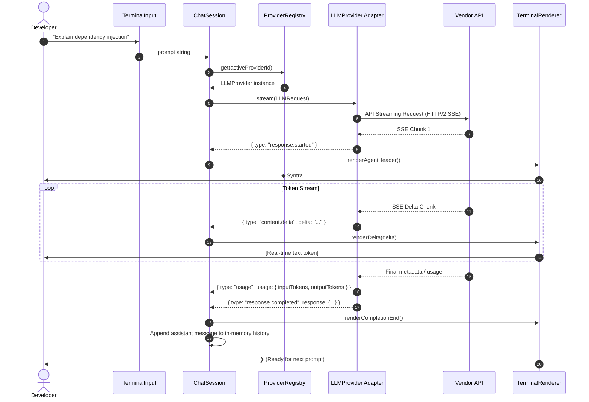

# Syntra Architecture Overview

Syntra is a local-first autonomous intelligence runtime and CLI platform.

Phase 1 provides the core foundation:
- Modular CLI routing and interactive REPL
- Provider-independent LLM abstraction
- AsyncIterable-first streaming architecture
- Centralized provider registry and vendor adapters
- Clean separation of presentation and domain services
- Secure credential management and runtime secret redaction

---

## 1. High-Level Component Architecture

```mermaid
flowchart TD
    subgraph Presentation ["Presentation Layer (apps/cli)"]
        CLI["Syntra CLI (Commander.js)"]
        Renderer["TerminalRenderer (picocolors)"]
        Input["TerminalInput (readline/promises)"]
        Session["ChatSession (REPL & State)"]
        Slash["SlashCommandHandler (/help, /model, etc.)"]
    end

    subgraph ConfigLayer ["Configuration & Security (@syntra/config & @syntra/shared)"]
        ConfigMgr["ConfigManager (~/.syntra/config.json)"]
        Creds["CredentialStore (Env / AES-256 Storage)"]
        Redact["Secret Redaction & Logger"]
        RetryUtil["Retry & Backoff Utility"]
    end

    subgraph CoreDomain ["Core Domain (@syntra/core)"]
        ProviderContract["LLMProvider Interface"]
        DomainEvents["LLMStreamEvent Union"]
        DomainErrors["Domain Errors (LLMError hierarchy)"]
        NormalizedTypes["LLMMessage / LLMRequest / ModelInfo"]
    end

    subgraph ProvidersLayer ["Provider Adapters (@syntra/providers)"]
        Registry["ProviderRegistry"]
        OpenAI["OpenAIProvider"]
        Anthropic["AnthropicProvider"]
        Gemini["GeminiProvider"]
        Mock["MockLLMProvider"]
    end

    subgraph Vendors ["Vendor SDKs"]
        OpenAISDK["OpenAI SDK"]
        AnthropicSDK["@anthropic-ai/sdk"]
        GeminiSDK["@google/genai SDK"]
    end

    CLI --> Session
    CLI --> ConfigMgr
    Session --> Renderer
    Session --> Input
    Session --> Slash
    Session --> Registry

    Registry --> ProviderContract
    OpenAI -.->|implements| ProviderContract
    Anthropic -.->|implements| ProviderContract
    Gemini -.->|implements| ProviderContract
    Mock -.->|implements| ProviderContract

    OpenAI --> OpenAISDK
    Anthropic --> AnthropicSDK
    Gemini --> GeminiSDK

    OpenAI --> Creds
    Anthropic --> Creds
    Gemini --> Creds
```



---

## 2. Streaming Request Lifecycle

Syntra is streaming-first. The provider adapter yields typed stream events over an `AsyncIterable<LLMStreamEvent>`.



---

## 3. Dependency Direction & Inversion

Syntra follows **Clean Architecture** principles strictly:

1. **Independent Core (`@syntra/core`)**: Has zero knowledge of vendor SDKs, CLI libraries, terminal colors, or file systems. It only exports domain entities, error types, and provider interfaces.
2. **Pluggable Providers (`@syntra/providers`)**: Implements `@syntra/core` interfaces. It depends on vendor SDKs and translates raw payloads into canonical Syntra types.
3. **Configuration & Security (`@syntra/config`)**: Manages non-volatile storage and credentials. Implements `CredentialStore` interface with support for environment variables and encrypted local files.
4. **Presentation (`apps/cli`)**: Orchestrates the CLI commands, interactive REPL loop, input prompting, and user formatting.

No outer layer details leak inward.

---

## 4. Error Handling & Normalization

Vendor-specific error types (e.g. `OpenAI.APIError`, `Anthropic.APIError`, gRPC errors) are caught inside adapter boundaries and mapped to canonical Syntra domain errors:

- `AuthenticationError` (HTTP 401)
- `RateLimitError` (HTTP 429)
- `ProviderUnavailableError` (HTTP 500, 502, 503, 504)
- `ContextLengthError` (Prompt exceeds context window)
- `InvalidRequestError` (Bad parameters)
- `CancellationError` (Triggered via `AbortController` / `Ctrl+C`)

The presentation layer formats these cleanly:
```text
✗ OpenAI rate limit reached.

Try again later or select another provider with:
  /provider
```
Raw vendor stack traces are suppressed in standard mode, and only displayed when `--debug` or `SYNTRA_DEBUG=true` is set.

---

## 5. Cancellation Architecture

When the user triggers `Ctrl+C` during an active generation:
1. `ChatSession` invokes `abort()` on the active `AbortController`.
2. The `AbortSignal` propagates through the provider adapter to the vendor HTTP client.
3. The streaming generator catches the abortion, emits or throws a `CancellationError`.
4. `TerminalRenderer` displays `Generation cancelled.` and returns cleanly to prompt `❯ `.
5. The session remains alive; pressing `Ctrl+C` on an empty prompt exits the session cleanly.
